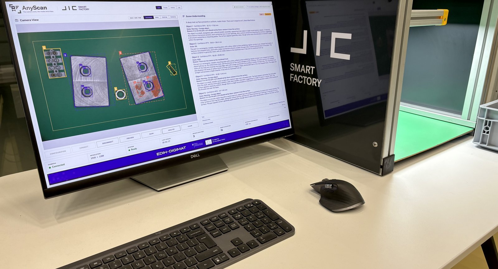
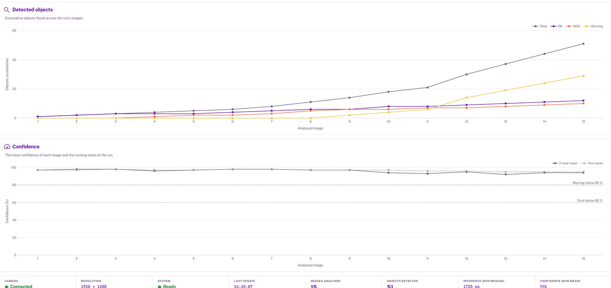
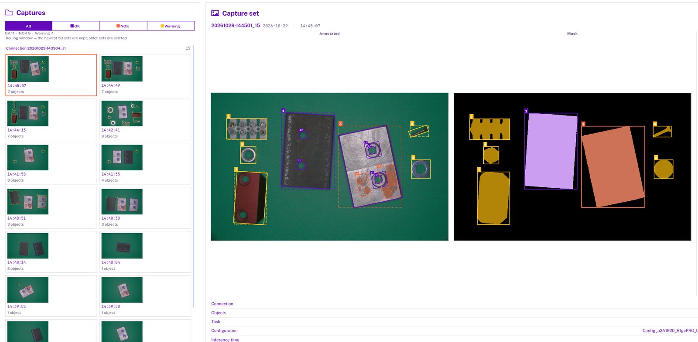
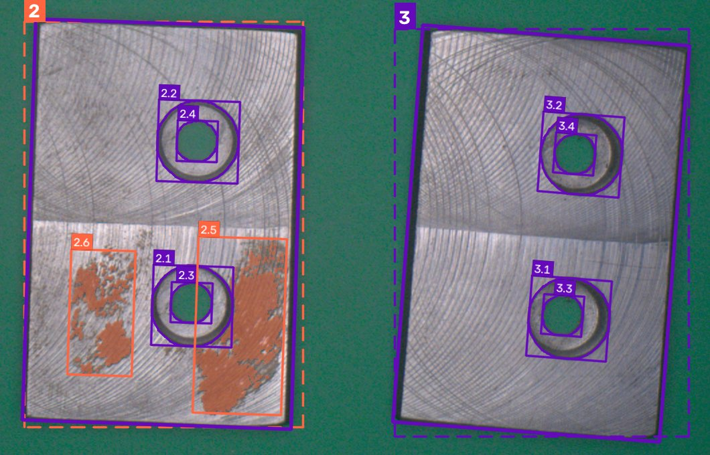
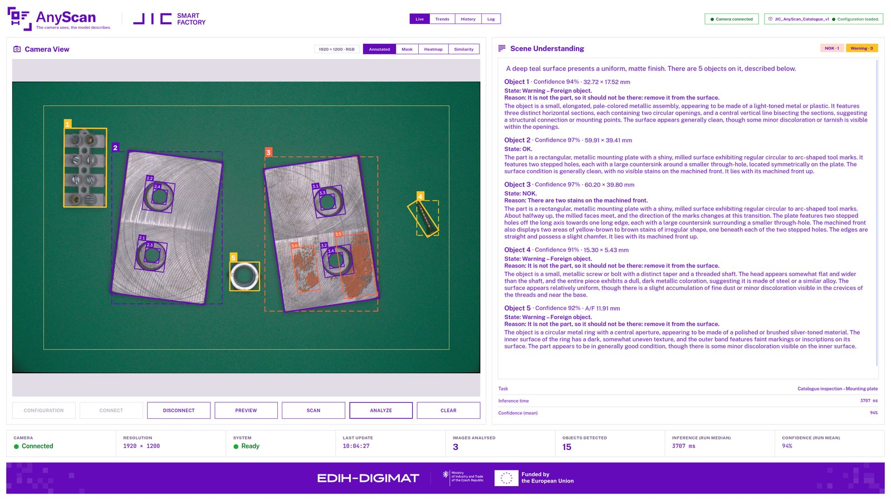
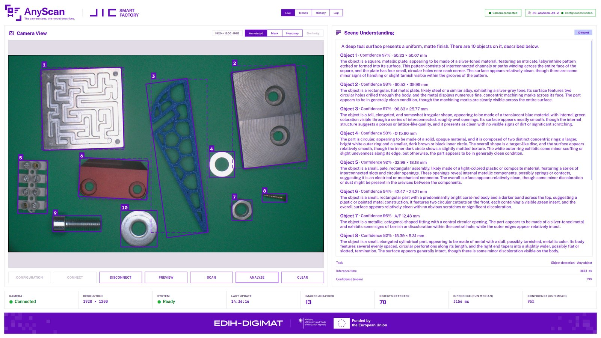
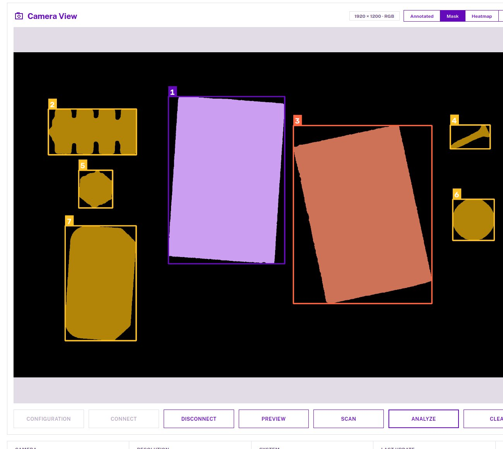
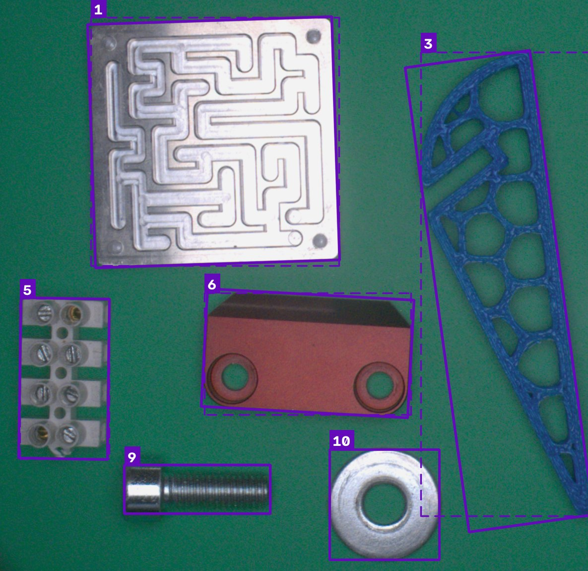

# AnyScan

*The camera sees, the model describes.*

AnyScan is a desktop inspection station for one Basler camera looking down at a work surface. It finds every
object on the table, describes each one with a local vision-language model, measures it in mm and records the
analysis. A catalogue mode also recognises the catalogued part, checks it and gives a state: OK, NOK or Warning.

![AnyScan architecture: in every mode the camera shows a live preview, then takes a fresh frame once nothing moves, two cues, fused, find every object, and each object is described in words and measured in mm. The desktop app shows Live, Trends, History and Log. A catalogue mode adds, for each object found, recognising the catalogued part, the inspection area (only a part wholly inside is judged, one outside is a part or a foreign object by similarity, size and colour), the checks on the side that is up (size, holes with each bore centred in its countersink, stains) and a state: OK, NOK or Warning, a Warning with its kind. It describes each object after its state and drops a sentence that contradicts the checks. The mode names the station, the station the calibration, and the catalogue item and empty-surface reference set the stages up too. Every analysis is recorded, with the session log, a run summary and the daily station events](images/anyscan-architecture.svg)

**Figure 1:** AnyScan's architecture, generated from the theme by `Example/UI/architecture_diagram.py` and never
edited by hand. Read it top to bottom: the frame, the two cues and their fusion, then each object's description and
measurement, and in a catalogue mode its state.

Two independent cues are fused, so an object is kept if **either** one finds it ([Detection logic](#detection-logic)).



**Figure 2:** The station at JIC Smart Factory, AnyScan in the mounting-plate catalogue mode, 2026-11-03.


**Figure 3:** SCAN, then ANALYZE, replayed offscreen by `Example/UI/analysis_animation.py` on a frame recorded at
station SF4 on 2026-10-29, not a live recording. The analysis took 19 s on the Mac and is shown in 3 s.

> [!IMPORTANT]
> Sizes are repeatable, not absolute, and their scale is not verified. The describer is not a defect detector, and a
> catalogue mode's OK covers only its item's checks.

**Contents:** [Setup](#setup) · [Workflow](#workflow) · [Configuration](#configuration) ·
[Validation](#validation) · [Tests](#tests) · [Detection logic](#detection-logic) ·
[Platform](#platform) · [Repository layout](#repository-layout) · [Swapping a component](#swapping-a-component) ·
[Authors](#authors) · [Funding](#funding) · [Licence note](#licence-note)

## Setup

AnyScan runs on **macOS on Apple silicon** (Verified, measured) and on **Linux with an NVIDIA GPU** (Verified on one
machine, 2026-09-29, and in real use on it as station SF4 on 2026-10-29). Windows is Never tried, not a target
([Platform](#platform)). The installer creates the virtual environment, installs the dependencies for the hardware
(Metal, or MLX's CUDA 12 or 13 backend by the driver) and downloads the three models, each checksum-verified. It is
safe to re-run. Every later command runs `.venv/bin/python`:

```bash
./install.sh                 # or ./install.sh --detect-only to see what it would do
```

On Linux it stops, naming the card and its memory, when GPU 0 has less than 11 GB or there is no usable NVIDIA GPU.
`--cpu` installs the CPU builds instead (unmeasured, expected to be far slower). **Some installer paths have never
run for real**: the full Linux install, the Gemma download on macOS, the DINOv2 download from scratch, the CUDA 12 and
CPU branches and every refusal ran against stubs only. If one fails, please report it with the installer's output.

<details>
<summary><b>The three models, and setup by hand</b>: the environment, the OpenCV fix and the model downloads</summary>

| Model, in `models/` (not tracked in git) | Used for | Download |
|---|---|---:|
| Gemma 4 E4B, `mlx-community/gemma-4-e4b-it-4bit` (4-bit MLX) | describing each object | 5.2 GB |
| FastSAM-x | segmenting the frame, finding holes | 145 MB |
| DINOv2 base, `facebook/dinov2-base` | recognising the catalogue part (catalogue modes) | 346 MB |

The window and the tests run without the weights. A missing one is reported, with what to do, when first used.

Python 3.10 to 3.12, the installer's range (developed and characterized on 3.10, run on 3.11 on Linux, never on
3.12):

```bash
python3 -m venv .venv
.venv/bin/python -m pip install -r requirements.txt
.venv/bin/python -m pip uninstall -y opencv-python
.venv/bin/python -m pip install --force-reinstall --no-deps opencv-python-headless==5.0.0.93
```

The last two lines leave OpenCV's headless build only. ultralytics and mlx-vlm pull in OpenCV's GUI build, whose Qt
plugins make the window abort with "Could not load the Qt platform plugin xcb". Uninstalling it also deletes files
the two builds share, so the headless build is reinstalled whole. `./install.sh` does this after every install, and
`App/run.py` refuses to start, naming these two commands, while the GUI build is there. On Linux, `mlx` also needs
its backend, one of `requirements/linux-cuda12.txt`, `linux-cuda13.txt` or `linux-cpu.txt`, and PyTorch from the
matching index (`cu126`, `cu130` or `cpu`), see [Platform](#platform). `pypylon` (the Basler SDK) is needed only for
the live camera.

Download the describer, Gemma 4 E4B, at the revision the application was measured with (10 files, 5.2 GB). The
public repository needs no token, and `hf` is the Hugging Face CLI from `huggingface_hub`:

```bash
.venv/bin/hf download mlx-community/gemma-4-e4b-it-4bit \
    --revision 475b9088d29754a3379866cf5aeb6b41acd313c2 \
    --local-dir models/gemma-4-e4b-it-4bit
```

The segmenter, FastSAM-x (upstream: <https://docs.ultralytics.com/models/fast-sam/>):

```bash
.venv/bin/python -c "from ultralytics import FastSAM; FastSAM('FastSAM-x.pt')"
mkdir -p models/FastSAM && mv FastSAM-x.pt models/FastSAM/
```

The catalogue modes' identifier, DINOv2 base:

```bash
.venv/bin/hf download facebook/dinov2-base README.md config.json preprocessor_config.json model.safetensors --revision f9e44c814b77203eaa57a6bdbbd535f21ede1415 --local-dir models/dinov2-base
```

Without the Gemma weights at `models/gemma-4-e4b-it-4bit/`, ANALYZE fails with a message naming the missing
directory. `models/.gitkeep` lists the expected directory contents.

</details>

<details>
<summary><b>Back to an earlier release</b>: the tag, the reinstall, and what git does not hold</summary>

On the station, with the application closed:

```bash
git status --short                 # a changed tracked file (Configuration/) blocks the checkout: copy it aside first
git rev-parse --short HEAD         # note the commit you leave, to come back
git fetch --tags
git checkout <tag>                 # example: replace <tag> with the release, such as v1.0
./install.sh
```

`./install.sh` installs that release's `requirements.txt` into the existing `.venv`. Only `opencv-python-headless`,
`mlx` and `mlx-vlm` are pinned (`==`). The others are floors (`>=`), so a newer version already installed stays. It
verifies FastSAM-x by its SHA-256 and Gemma and DINOv2 file by file at the revisions that release pins, and fetches
only what differs. Git holds none of these:

- the model weights in `models/` (the installer fetches them),
- the station's own mode file, kept outside the repository and started with `--config`: a field that release
  requires and the file lacks fails the load, naming the file and the line,
- calibrations written by `calibrate.py` into `Configuration/Calibration/` and not committed, and its captures in
  `Data/Images/Calibration/`,
- the session logs, capture sets and station events in `logger/`, and the scans in `Data/Results/`.

`git checkout <the noted commit>` and `./install.sh` return to where you were.

</details>

## Workflow

From a fresh clone to the first analysis, in order. Steps 2 and 3 set a station up once: repeat both when the camera,
the lens, its focus or the mount changes, and step 3 alone when the light or the table changes.

1. **Install**: `./install.sh` ([Setup](#setup)) writes `.venv/` and the three models into `models/`. It worked when it
   prints `Setup complete in … s`. On Linux it stops when GPU 0 has less than 11 GB.
2. **Calibrate the camera**, connected over GigE. Print `Data/Calibration/Checkerboard_11x8_12mm_A4.pdf`, caliper
   one square, capture views of the board flat and tilted, and solve them:
   ```bash
   .venv/bin/python Example/Camera/calibrate.py --capture --board-squares 11x8    # f flat, t tilted, q quit
   .venv/bin/python Example/Camera/calibrate.py --images Data/Images/Calibration/<timestamp> --board-squares 11x8 \
       --square-mm <calipered> --board-height-mm <board height>                  # example: replace the <...>
   ```
   It writes a new `Configuration/Calibration/Calibration_<Hardware>_<YYYYMMDD-HHMMSS>.yaml`, reports each view and
   the RMS (the rig's: 63 views, 0.45 px) and prints the station file's line to change. Change it. A set captured
   at another sensor window or with another board is refused, and nothing is written.
3. **Shoot the empty-surface reference** with the table clear: `.venv/bin/python Example/Camera/make_reference.py`
   writes `Data/Images/Background/Image_Background_<NNN>.png` and its sidecar (8 frames, about 2.6 s) and prints the
   station line to change. Change it. Anything part-sized left on the table is listed, and nothing is written.
4. **Choose the mode**: `Configuration/Mode/Config_<Hardware>_Mode_Seg_Anything.yaml` finds, describes and measures
   every object, `…_Mode_Mounting_Plate.yaml` also checks the mounting plate. A station runs its own copy
   ([Configuration](#configuration)).
5. **Start**: `.venv/bin/python App/run.py` (a station adds `--config <its copy>`), then CONFIGURATION → **Load**,
   4.8 s on the Linux station ([Platform](#platform)). CONNECT becomes available. A broken file is named, with its line.
6. **CONNECT** sets the camera's window, exposure, gain and white balance. A camera another program holds is named.
7. **PREVIEW** (optional) shows the table live with the inspection area, about 3.7 frames a second on the rig.
8. **SCAN** takes one frame once the scene is still, about 0.59 s on the rig, or none (*Not scanned*) after a second.
9. **ANALYZE** finds, describes and measures each object, and in a catalogue mode gives each a state: 0.65 s per
   object on the Linux station, 2.20 s on the M2 Pro. **CLEAR** resets the figures, `Esc` closes.
10. **The results**, in `logger/`: each analysis's capture set in `captures/<connection>/` (the newest 50, listed in
    History), the session log `log_<date>_<time>.txt` and the run summary `log_<Hardware>.csv`. Closing writes the
    day's station events to `<station-event directory>/<YYYY-MM-DD>.csv`.

<details>
<summary><b>Without the camera, and one frame without the window</b>: <code>--frame</code> and <code>scan.py</code></summary>

Without the camera, pass a saved 1920×1200 frame (a configuration must still be loaded, which needs the weights).
`scan.py` saves one frame to `Data/Results/Scan_<timestamp>.png` while the application is not connected (`--help`):

```bash
.venv/bin/python App/run.py --frame path/to/frame.png  # example: replace path/to/frame.png
.venv/bin/python Example/Camera/scan.py                # as SCAN: waits for a still scene, refuses a moving one (exit 1)
.venv/bin/python Example/Camera/scan.py --no-stillness # one frame at once, without the stillness check
```

</details>

<table>
<tr>
<td width="33%" valign="top"><a href="images/anyscan-trends-catalogue.jpg"></a>
<br><b>Figure 4:</b> Trends, mounting-plate catalogue mode, station SF4, 2026-10-29: the objects found over the session, in total and per state, and each image's mean confidence.</td>
<td width="33%" valign="top"><a href="images/anyscan-history-catalogue.jpg"></a>
<br><b>Figure 5:</b> History, same session: the capture sets filtered by state (All, OK, NOK, Warning), the chosen set's annotated frame, mask and report.</td>
<td width="33%" valign="top"><a href="images/anyscan-scan-nok-ok.jpg"></a>
<br><b>Figure 6:</b> A recorded frame, catalogue mode, SF4, 2026-10-29, cropped: plate 2 NOK for two stains (2.5, 2.6), plate 3 OK, each hole's countersink and through-hole boxed.</td>
</tr>
</table>

<details>
<summary><b>More screenshots and scans</b>: the Live view in each mode, the Mask view, a Segment Anything frame</summary>

<table>
<tr>
<td width="33%" valign="top"><a href="images/anyscan-live-catalogue.jpg"></a>
<br><b>Figure 7:</b> The Live view in the mounting-plate catalogue mode, 2026-11-03: one plate OK, one NOK for two stains on its machined front (a catalogued defect), three foreign objects as Warnings.</td>
<td width="33%" valign="top"><a href="images/anyscan-live-segment-anything.jpg"></a>
<br><b>Figure 8:</b> The Live view in the Segment Anything mode at station SF4, 2026-10-29: every object found, described and measured, no state.</td>
<td width="33%" valign="top"><a href="images/anyscan-mask-catalogue.jpg"></a>
<br><b>Figure 9:</b> The Mask view, same session: each object's label mask on black, in its state's colour.</td>
</tr>
<tr>
<td width="33%" valign="top"><a href="images/anyscan-scan-segment-anything.jpg"></a>
<br><b>Figure 10:</b> A recorded frame, Segment Anything mode, SF4, 2026-10-29, cropped: every object numbered and outlined (solid the rotated outline, dashed the outer box), its size in the Scene Understanding panel (1 at 50.2 × 50.1 mm, 3 at 96.3 × 25.8 mm).</td>
</tr>
</table>

</details>

## Configuration

Three kinds of file, each in its own folder, linked by name (a reference is a file name, never a path):

<details>
<summary><b>The file names</b>: each kind's folder and pattern, and the name it links to</summary>

```text
Configuration/Mode/Config_<Hardware>_Mode_<Mode>.yaml      Station: Station_<...>.yaml
Configuration/Station/Station_<Hardware>[_<Name>].yaml     Calibration: Calibration_<...>.yaml
Configuration/Calibration/Calibration_<Hardware>_<YYYYMMDD-HHMMSS>.yaml
```

</details>

<details>
<summary><b>What each file holds</b>, and how the three are checked when they load</summary>

- **Mode**: what a user changes without code (models, prompts, thresholds, and a catalogue mode's item,
  `Data/Catalogue/<item>/<item>.yaml`). Its comments give every field's default and unit.
- **Station**: the camera, lens, lighting, sensor window, empty-surface reference, inspection area and the
  calibration in force. A mode file that holds any of these fails to load.
- **Calibration**: a new file from every `Example/Camera/calibrate.py` run ([Workflow](#workflow), step 2).

`Configuration.Core.Load_Configuration` checks the three as a whole: a missing required field, a link that disagrees
or a reference that does not match its sidecar fails the load, naming the file and the line. A missing optional field
takes its default and is logged. CONFIGURATION lists `Configuration/Mode/`, and **Load** applies one (on failure the
previous one stays). After the first CONNECT it is fixed for the run.

</details>

**Changing the lamp without updating `Camera.Lighting` goes unnoticed.** **A station sets its station-event
directory in a local copy of the mode file, never the shipped one**: copy it outside the repository, keeping its
name, change only `General.Station_Events.Directory`, and start with `--config <that copy>`.

## Validation

What ran on real hardware, and what did not. No part was calipered and no session recorded each part's expected
result, so nothing here measures accuracy: it shows the station working.

**At station SF4, 2026-10-29.** Two sessions of real use at JIC Smart Factory (Linux, RTX 5070 Ti). Segment Anything:
13 scans, 70 objects, each described and measured. Mounting plate: 15 scans, 51 objects, 12 OK, 10 NOK and 29 Warning
(27 foreign objects, 2 outside the area). Its 20 plate judgements were within tolerance on all 212 feature checks, at
59.78–60.69 × 39.21–40.64 mm against 60 × 40 ± 1.5 mm, and the catalogued stain check reported the stains in all 8
judgements of a stained front. v1.0 reproduced both sessions offline on macOS from the recorded frames: all 121
objects kept their state, warning kind and reason, sizes within 0.284 mm and confidence within 1 point. The wording of
the descriptions differs (15 of 121 identical).

<details>
<summary><b>On the rig, 2026-09-28 to 2026-10-16</b>: the calibration, the camera, the test frames, what is not yet run</summary>

The calibration was solved from 63 views (RMS 0.45 px, 0.102 mm/px), and the
preview and the scan ran on the rig's camera (3.70 frames a second, a scan in 0.586 s). The suite re-analyses the 41
recorded test frames (150 objects) against each frame's expected states, and 78 mounting-plate frames out to 66.6 mm
from the frame centre (beyond 50 mm only by the right edge), every side, hole and stain (the catalogued checks) as
labelled. Not yet run: a parts session (defects, low contrast, a harsh shadow), the inspection area's left edge and
corners, a cable pull, and a moving hand under SCAN.

</details>

## Tests

None needs a camera. They mirror `src/` as `test/<Domain>/test_<module>.py`, with integration and installer tests:

```bash
.venv/bin/python -m pytest              # the default run
.venv/bin/python -m pytest --runslow    # also runs the `slow` tests, which need the weights
```

With the FastSAM and Gemma weights the default run smoke-tests the real `Analyze`. Without them it prints
`REAL VISION PATH NOT VERIFIED` and passes.

<details>
<summary><b>The golden file</b>: updating it after an intended change</summary>

`test/Vision/test_characterize.py` has a golden file. After an intended change:

```bash
.venv/bin/python -m pytest test/Vision/test_characterize.py --update-golden
git diff test/Vision/data/characterization.txt
```

</details>

## Detection logic

SCAN takes the first frame with no movement since the one before (`Camera.Utilities.Stillness.Is_Still`), and
`Vision_Pipeline_Cls.Analyze` (`src/Vision/Core.py`) runs the stages every mode shares (modules under
`src/Vision/Utilities/` unless named):


<details>
<summary><b>The four stages</b>: background subtraction, FastSAM, fusion, description, each with its module</summary>

```text
(1) background subtraction  Segmentation.Background_Difference   what changed against the empty-surface reference
(2) FastSAM segmentation    Segmenter.Fast_Sam_Cls               object instances, independent of the reference
(3) fusion                  Fusion.Fuse_Objects                  (1) OR (2), split, area-filtered, left to right
(4) description             Describers.Gemma_Describer_Cls       a padded, isolated, contrast-stretched crop each
```

</details>

Then `Reporting.Compose` writes the sentences and `Measure.Measure_Objects` the sizes (A x B, Ø or A/F, in mm). A
**detect-only mode** (Segment Anything) runs these as listed, and a **catalogue mode** measures, recognises and checks
each object before stage 4, then describes it with what the checks found. Each threshold lies between measured
values, except the 1 mm² stain area (the owner's ruling) and the 1.7 area ratio (no measurement recorded).

<details>
<summary><b>The catalogue stages</b>: recognition, the inspection area, the side up, holes, stains and the state</summary>

1. **Measurement and outline** (`Measure.Measure_Objects`, `Dimensions.Check_Objects`): the size at the part's top
   face against the item's outline and its tolerance.
2. **Recognition** (`Identifier.Dino_Identifier_Cls`, `Classify.Best_Match`, `Classify.Classify`): each object's
   upright crop against the item's reference image of each side, by DINOv2. An area 1.7× the part's or more is a
   Warning, several parts. A similarity of 0.75 or more is the part, OK or NOK by its outline. The outline alone
   within tolerance is NOK. Anything else is a Warning, foreign object.
3. **Inspection area** (`Classify.Inspection_Area_Px`, `Inside_Area`, `Resembles_Part`, `Settle_Area`): only an object
   wholly inside the frame inset by the station's `Inspection_Area` is judged. Outside, it is a Warning: outside area
   when it resembles the part (similarity 0.657 or more, mean saturation 76.3 or less, its extent no larger than the
   part's diagonal plus its tolerance), else foreign object.
4. **Side up** (`Holes.Hole_Candidates`, `Holes.Side_Evidence`, `Classify.Decide_Side`, `Classify.Settle_Side`):
   FastSAM again on the upright crop for holes. DINOv2's side when its margin over the next is 0.265 or more, else
   the side a hole only it has shows. Sides that disagree are a Warning, side unclear. Holes against look are a Warning,
   side mismatch.
5. **Holes** (`Holes.Check_Holes`, `Classify.Apply_Holes`): each group's count near its positions, diameter, edge
   distances and pitch, and each stepped hole's bore within 0.85 mm of its countersink once the camera's predicted
   shift is taken out. A missing, extra or out-of-tolerance hole makes the part NOK.
6. **Stains** (`Stain.Check_Stain`, `Classify.Apply_Stain`): the item's colour band inside the part, its edge and
   holes left out. A region of 1 mm² or more makes it NOK.
7. **State** (`Reporting.State_Word`, `Reporting.Badges`): OK, NOK or Warning with its kind and the operator's action.
8. **Description, held to the checks** (`Reporting.Describer_Prompt`, `Guard_Description`, `Restated_Prompt`): the
   prompt carries the side and what the checks found, no number. A sentence with a number, naming the checks or
   contradicting them is dropped. On a contradiction it is asked once more. The state is never changed.
   `Classify.Similarity_Grid` draws the Similarity view.

</details>

## Platform

| Platform | Status | What is known |
|---|---|---|
| **macOS, Apple silicon** | **Verified, measured** | MLX on the Apple GPU (Metal), on a 16 GB M2 Pro. 2.20 s per object (warm) and a 9.35 GB pipeline peak, on a seven-frame test set before the current one (2026-09-25). A replay repeats word for word on the same machine (2026-10-29). |
| **Linux** | **Verified on one machine, 2026-09-29, and in real use on it as station SF4 on 2026-10-29** | MLX's CUDA backend on an NVIDIA GPU with at least 11 GB (the installer refuses below it). On an RTX 5070 Ti with the CUDA 13 backend: 0.65 s per object (warm), 9.5 GB GPU peak for the whole application, output identical word for word between two processes. Not compared with the Mac's text. |
| **Windows** | **Never tried, not a target** | Nothing known prevents it (`mlx` publishes Windows wheels), but it is not supported. |

<details>
<summary><b>The models and the Linux measurement</b>: what decides where AnyScan runs, the machine, the installer's run and the numbers</summary>

- **Determinism does not travel**: greedy decoding fixes the sampler, but another backend can still change the text
  through floating-point differences. No test pins live describer text.


- **The models**: the describer, Gemma 4 E4B in 4-bit **MLX** at revision `475b908`, decides where AnyScan runs, and the
  rest is portable. DINOv2 base (`f9e44c8`, catalogue modes) only compares objects with the item's reference images.
  No packaging recipe has been verified on any platform. Run from source.
- **The machine** (2026-09-29): AMD Ryzen 9 9950X3D, 29 GiB RAM, NVIDIA GeForce RTX 5070 Ti (16 GB, compute
  capability 12.0), driver 595.91.07 (CUDA 13.2), Ubuntu, Python 3.11.16, MLX 0.32.2 + `mlx-cuda-13`, mlx-vlm 0.7.2,
  PyTorch 2.14.0+cu130.
- **The numbers**, through the application's path (`Load_Configuration` → `Configure` → `Analyze`) on the eight
  frames of an earlier test set with the shipped configuration (not re-run on the current one): E4B 0.65 s per
  object (the mean of 37, ranging 0.51–0.93 s, and 0.64–0.66 s over two processes), model load 3.9 s, configure (load and
  warm-up) 4.8 s (9.4 s once, on the first run after the download), and FastSAM loads in 0.08 s and segments a frame in
  34–55 ms on CUDA. Peaks: 6.99 GB MLX, 9.5 GB GPU for the whole application (`nvidia-smi`), 4.0 GB process RSS. The
  first analysis after a load was no slower than the next (not timed). The suite of that day passed with and without
  `--runslow`.
- **The installer**: on Linux the backend comes from one requirements file per backend,
  `requirements/linux-cuda12.txt`, `linux-cuda13.txt` or `linux-cpu.txt`, and PyTorch's CUDA build from the matching
  index (`cu126`, `cu130` or `cpu`). `./install.sh` chooses both from the NVIDIA driver after checking GPU 0's memory
  (11 GB minimum), and warns when more than 1.5 GB of it is already in use. On this machine its detection ran for real
  (`--detect-only`: driver 595.91.07, the CUDA 13 backend and the `cu130` build, 15.9 GB on GPU 0), and so did its
  Gemma step, which downloaded and verified E4B. The full install was not run there, and the other Linux branches are
  tested with stubbed commands only.

</details>

## Repository layout

<details>
<summary><b>The folders</b>: what is committed, what is git-ignored, the packages under <code>src/</code>, the figures</summary>

`Data/` is input and output, `images/` is documentation, and only `models/` is supplied by you (`./install.sh`).

```text
App/run.py                the application (entry point)
App/assets/               the logos, the window icon and the fonts (Public Sans, JetBrains Mono, OFL); built
src/                      the Qt-free domain packages and the Qt UI (below)
Example/                  runnable scripts: scan, preview_check, calibrate, calibration_tilt_study,
                          generate_checkerboard, make_reference, analyze, evaluate_describer, architecture_diagram,
                          analysis_animation, build_logo, build_fonts
Configuration/            the mode, station and calibration files
Data/Catalogue/           the catalogue items (the mounting plate's file and reference images); committed
Data/Images/Test/         the 41 test frames (Image_055-095, each a capture set's undistorted _raw.png); committed
Data/Images/Edge/         the edge-of-view regression crops; committed
Data/Images/Background/   the empty-surface reference(s) and their provenance sidecars; committed
Data/Images/Calibration/  calibration capture sets (calibrate.py --capture); git-ignored
Data/Calibration/         the calibration board to print, Checkerboard_11x8_12mm_A4.pdf; committed
Data/Results/             analyze.py and scan.py output; git-ignored
images/                   the README's figures, photographs and screenshots, and the logo; committed
models/                   the model weights, downloaded per Setup; git-ignored
```

Under `src/`, the application is `Camera/` (the camera backends and the pypylon driver), `Vision/` (the pipeline,
the segmenter, the describer, the identifier and their utilities), `Reporting/` (the report composer, the panel's
one voice), `UI/` (the widgets, the window and the workers), `Logger/` (the session log and the station events),
`Parameters/` (the data structures) and
`Configuration/` (`Configuration/Core.py`, the one reader of the configuration files). The domain packages import
with PyQt5 unavailable, a tested contract. `Calibration/` holds the multi-view checkerboard calibration that
`calibrate.py` drives, and `Transformation/` is an inherited robotics library that nothing imports today.

The figures are regenerated, never edited. After replacing `images/anyscan-logo.svg`, rebuild the logo copies, then
the diagram, which embeds the logo. `test/UI/test_brand_figures.py` fails when they disagree:

```bash
.venv/bin/python Example/UI/build_logo.py
.venv/bin/python Example/UI/architecture_diagram.py
```

A frame is added to `Data/Images/Test/` under a new name, never over an old one, and only together with the tests'
expectations: they refer to the frames by name.

</details>

## Swapping a component

<details>
<summary><b>The camera and the describer</b>: the two classes to subclass</summary>

- **Camera**: subclass `Camera_Backend_Cls` (`src/Camera/Core.py`) and implement `_Open`, `_Close` and `_Grab`,
  which returns an **RGB NumPy array**, the exchange format for the whole application.
- **Describer**: subclass `Describer_Backend_Cls` (`src/Vision/Describers.py`), implement `Loaded`, `Load`,
  `Describe(crop_bgr, purpose, prompt)` and `Last_Tokens`, and create it where `Vision.Core` creates
  `Gemma_Describer_Cls`. Every sentence the operator reads is still written by the report composer
  (`src/Reporting/Core.py`).

</details>

## Authors

<table><tr><td align="center"><a href="https://github.com/rparak"><br /><strong>Roman Parak</strong></a><br />Author</td>
<td align="center"><a href="https://github.com/LukasMoravansky"><br /><strong>Lukas Moravansky</strong></a><br />Contributor</td>
<td align="center"><a href="https://github.com/vojtechmarek13"><br /><strong>Vojtěch Marek</strong></a><br />Contributor</td>
<td align="center"><a href="https://github.com/piifl"><br /><strong>Filip Rusnak</strong></a><br />Contributor</td></tr></table>

## Funding

Developed within internal research at JIC Smart Factory as a demonstrator through which the EDIH-DIGIMAT
project shows small and medium-sized enterprises (SMEs) how AI-based visual inspection can work on their own parts.


**Figure 11:** The project's, the Ministry's and the EU's logos, generated with Figure 1.

Funded by the European Union. Views and opinions expressed are however those of the author(s) only and do not
necessarily reflect those of the European Union or European Commission. Neither the European Union nor the granting
authority can be held responsible for them.

## Licence note

AnyScan's own code is under the MIT licence ([LICENSE](LICENSE)), held by JIC Smart Factory. The libraries, models
and fonts keep their own licences, and no model ships with the repository. Three of them limit what you may do when
you reuse AnyScan. In plain words, not legal advice:

- **PyQt5 (GPL-3.0)**: whoever distributes AnyScan together with PyQt5 distributes the combination under GPL-3.0.
  A closed-source redistribution needs Riverbank Computing's commercial licence.
- **ultralytics and the FastSAM-x weights (AGPL-3.0)**: using them is free. Whoever distributes a modified version,
  or offers one to users over a network, must provide its source under AGPL-3.0.
- **The Basler pylon runtime (proprietary)**: it comes inside the `pypylon` package under Basler's end-user licence
  agreement, which governs its use and redistribution.

<details>
<summary><b>Third-party components</b>: each library, model, font and logo, what AnyScan uses it for, its licence</summary>

| Component | What AnyScan uses it for | Licence | Link |
|---|---|---|---|
| PyQt5 | the desktop window and its widgets | GPL-3.0, or Riverbank's commercial licence | [PyQt](https://www.riverbankcomputing.com/software/pyqt/) |
| Qt 5 (PyQt5-Qt5) | the Qt runtime under PyQt5 | LGPL-3.0 | [Qt licensing](https://www.qt.io/licensing/) |
| PyQt5-sip | PyQt5's binding layer | BSD-2-Clause | [sip](https://github.com/Python-SIP/sip) |
| NumPy | image and number arrays | BSD-3-Clause | [numpy.org](https://numpy.org/doc/stable/license.html) |
| OpenCV (`opencv-python-headless`) | image processing, undistortion, drawing | Apache-2.0 | [opencv-python](https://github.com/opencv/opencv-python) |
| Pillow | image files | MIT-CMU | [Pillow](https://github.com/python-pillow/Pillow/blob/main/LICENSE) |
| PyYAML | reading the configuration files | MIT | [PyYAML](https://github.com/yaml/pyyaml/blob/main/LICENSE) |
| pypylon | talking to the Basler camera | BSD-3-Clause (its own code) | [pypylon](https://github.com/basler/pypylon) |
| Basler pylon runtime | the camera driver, inside pypylon | Basler pylon end-user licence agreement (proprietary) | [Basler](https://www.baslerweb.com) |
| huggingface_hub | downloading Gemma and DINOv2 at install | Apache-2.0 | [huggingface_hub](https://github.com/huggingface/huggingface_hub) |
| PyTorch | running FastSAM and DINOv2 | BSD-3-Clause, with Apache-2.0, BSL-1.0 and MIT parts | [PyTorch](https://github.com/pytorch/pytorch/blob/main/LICENSE) |
| transformers | loading DINOv2 | Apache-2.0 | [transformers](https://github.com/huggingface/transformers) |
| ultralytics | running the FastSAM segmenter | AGPL-3.0 | [ultralytics](https://github.com/ultralytics/ultralytics) |
| MLX (`mlx`, `mlx-metal`, the Linux backends) | running Gemma on the GPU | MIT | [MLX](https://github.com/ml-explore/mlx) |
| mlx-vlm | Gemma's vision-language interface | MIT | [mlx-vlm](https://github.com/Blaizzy/mlx-vlm) |
| pytest | the tests | MIT | [pytest](https://github.com/pytest-dev/pytest/blob/main/LICENSE) |
| fontTools | building the bundled fonts (maintenance only) | MIT | [fonttools](https://github.com/fonttools/fonttools) |
| FastSAM-x weights | finding the objects in the frame | AGPL-3.0 | [FastSAM](https://github.com/CASIA-IVA-Lab/FastSAM) |
| Gemma 4 E4B, 4-bit MLX conversion | describing each object | Apache-2.0 | [base model](https://huggingface.co/google/gemma-4-E4B-it), [licence](https://ai.google.dev/gemma/docs/gemma_4_license) |
| DINOv2 base | recognising the catalogued part | Apache-2.0 | [model](https://huggingface.co/facebook/dinov2-base) |
| Public Sans, JetBrains Mono (`App/assets/fonts/`) | the window's typefaces | SIL Open Font License 1.1, beside the files | [Public Sans](https://github.com/uswds/public-sans), [JetBrains Mono](https://github.com/JetBrains/JetBrainsMono) |
| JIC Smart Factory, EDIH-DIGIMAT, Ministry and EU logos | the header and the funding band | their owners' usage rules, not a licence | — |

Gemma 4 E4B and DINOv2 base are under the Apache License 2.0, Public Sans and JetBrains Mono under the SIL Open Font
License 1.1. `google/gemma-4-E4B-it` is tagged `apache-2.0` at `fee6332`, the revision the weights were converted
from. The conversion's `license: gemma` tag looks like converter boilerplate, and the Gemma Terms of Use do not govern
Gemma 4.

</details>
