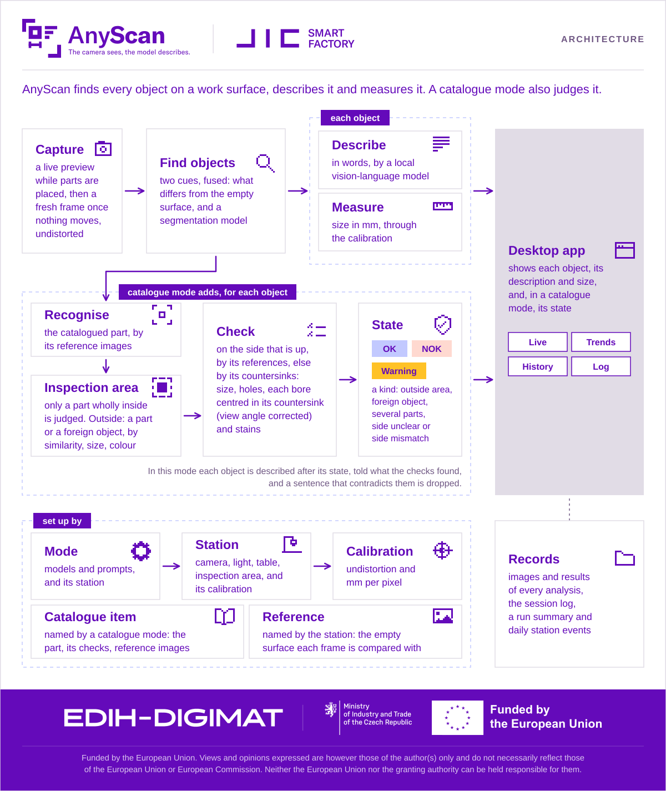

# AnyScan — capabilities

What the application does, for someone (or a future session) who needs to understand it quickly.
It is a map: each capability in a sentence or two, with a link to where it is explained in full.

| Question | Where |
|---|---|
| How do I install and run it? | [README](../README.md#setup) |
| What does it do? | This file |
| Why does it do it that way? | [design-decisions.md](design-decisions.md) |
| What limits a decision built on its output? | [README > Limitations](../README.md#limitations) |
| What odd behaviour is known and left open? | [KNOWN_ISSUES.md](../KNOWN_ISSUES.md) |
| What must be captured on the rig? | [capture-checklist.md](capture-checklist.md) |

Last reviewed against the code at commit `f1a4c88` (2026-10-08).

Nothing here is explained twice: where a reason or a limit matters, this file links to it.
`test/integration/test_capabilities_doc.py` checks this file against the code (see
[Keeping this file true](#keeping-this-file-true)).

## At a glance

AnyScan is a desktop inspection console for one Basler camera looking down at a work surface. A
frame of the surface with parts on it goes in. Out comes each part found, with a short description
from a local vision-language model, its size in mm when the camera is calibrated, a confidence, and
an annotated image. Every analysis is recorded on disk. It runs on Apple-silicon macOS and on Linux
with an NVIDIA GPU ([README > Platform](../README.md#platform)).

## Architecture

The diagram is generated by `Example/UI/architecture_diagram.py`. A test fails when the committed
file is not the generator's output, so regenerate it, never edit it.

### Packages

`App/run.py` starts the application. Everything it runs is under `src/`:

| Package | What it does | Qt |
|---|---|---|
| `Parameters` | The data structures (`*_Str`) and tokens every other package exchanges: detections, analyses, the loaded configuration, camera and calibration records, the theme. | No |
| `Configuration` | Reads and validates the mode and calibration files (`Load_Configuration`), writes calibrations (`Write_Calibration`), and builds the reference sidecar. The only reader of `Configuration/*.yaml`. | No |
| `Camera` | The camera backends (`Basler_Camera_Cls`, `File_Camera_Cls` for `--frame`): connect, set and read back the sensor window, grab, undistort, detect a lost connection. | No |
| `Vision` | The pipeline (`Vision_Pipeline_Cls`): background subtraction, FastSAM, fusion, Gemma description, measurement, the annotated image and label mask, the heatmap. | No |
| `Reporting` | The report composer, the one voice of every sentence the operator reads, and the Trends accumulator and chart maths. | No |
| `Logger` | The session log, the run-summary CSV and cycle accounting (`Logger.Core`), and the daily station event export (`Logger.Station_Events`). | No |
| `UI` | The window, its four views, the Configuration dialog, the worker threads, and the capture-set writer and reader (`UI/Capture.py`, Qt-free). | Yes |
| `Calibration` | The multi-view checkerboard solve behind `Example/Camera/calibrate.py`. The application never imports it. | No |
| `Transformation` | Inherited robotics maths (transforms, Euler angles, quaternions), reached only from `Example/`. Never rewritten. | No |

**Dependency direction.** `Parameters` is at the bottom, and `UI` is at the top and imports the
rest. Nothing below `UI` imports `UI` or Qt, and a domain module reports through injected callbacks,
never by holding the logger. The layer table, what enforces it, and the one-reader-per-format rule
are in the style skill's
[structure.md](../.claude/skills/project-style-rpx/references/structure.md), and are not repeated here.

### From a frame to the records

1. **Load.** `Configuration.Core.Load_Configuration` turns the mode file (and the calibration beside it)
   into one `Configuration_Str`. That object is what configures the camera, the pipeline
   (`Vision_Pipeline_Cls.Configure`, run in `Model_Load_Worker_Cls`) and the logger. No other module
   reads the YAML.
2. **Capture.** `Camera_Backend_Cls.Capture` returns an RGB NumPy array, undistorted when calibrated.
   This array is the exchange format for the whole application. The frame before undistortion is
   kept for the capture set.
3. **Analyse.** `Analysis_Worker_Cls` runs `Vision_Pipeline_Cls.Analyze` off the UI thread. It
   returns an `Analysis_Str`: the objects (mask, box, cue, description, measurement and confidence),
   the background sentence, the verdict, the timings and the heatmap. The annotated image and the
   label mask are drawn from it by `Vision.Utilities.Annotate`.
4. **Show.** The window shows the `Analysis_Str` in the Live view. The Trends accumulator takes its
   figures, and the status strip reads the same accumulator.
5. **Record.** `Capture_Writer_Cls` writes the capture set, which History reads back through
   `Read_Capture_Set`. The session logger writes every event to the session log, with event markers
   that `Logger.Core.Cycles` turns into cycles. At close it appends the run-summary CSV row, and
   `App/run.py` exports the day's station events from that log through `Logger.Station_Events`.

## Pipeline stages

`Vision_Pipeline_Cls.Analyze` (`src/Vision/Core.py`) runs each frame through four numbered stages,
then composes and measures. The numbers are the ones the README and the mode file's comments use.
[README > Detection logic](../README.md#detection-logic) has the diagram and the detail.

- **Before the stages: undistortion.** When a calibration is in force, the camera undistorts every
  frame before anything else sees it.
1. **Background subtraction.** The frame is differenced against the configured empty-surface
   reference, and everything that changed is foreground. There is no analysis without a reference.
2. **FastSAM segmentation.** Instance masks of everything in the frame, independent of the
   reference.
3. **Fusion.** The two cues are OR-ed, so an object is kept if **either** one finds it. The result
   is split into objects, filtered by area and numbered left to right, and each object records the
   cue that found it.
4. **Description.** Each object's crop goes to Gemma 4 E4B with the object prompt. The crop is
   padded, its neighbours are replaced by the reference, and it is contrast-stretched. One
   background sentence, from the reference, opens the reading.

- **Compose.** The report composer writes every sentence the operator reads. Each object's number
  and colour match its outline on the image.
- **Measurement.** Size and rotation from each mask, through the calibration's mm/px: `A × B`, `Ø`
  for round parts, `A/F` for hexagonal ones. Skipped when there is no calibration.

## Modes

A **mode** is one configuration file, `Configuration/Config_<Hardware>_Mode_<Mode>.yaml`: how the
scene is segmented and described, what the UI calls itself, and the confidence thresholds, on one
piece of hardware. The modes shipped today:

| Mode | File | What it does |
|---|---|---|
| Seg_Anything | `Config_a2A1920_51gcPRO_Computar_M1228_MPW3_Mode_Seg_Anything.yaml` | Finds every part on the surface (no class list), describes and measures it. Classification off. |

- The configuration is picked in the **CONFIGURATION** dialog and is fixed after the first CONNECT.
  Changing it means restarting the application. Another camera means restarting with `--config`.
- **Classification** (`General.Classification.Enabled`) exposes the OK/NOK verdict UI. Nothing
  classifies yet, so with it on every object is OK
  ([*Classification is a per-configuration switch…*](design-decisions.md#classification-is-a-per-configuration-switch-that-exposes-the-verdict-ui-not-one-that-creates-it)).
- **Without a camera**, `python App/run.py --frame <png>` analyses a saved frame of the reference's
  size.

## Run sequence

1. **Start, then CONFIGURATION → Load.** The configuration is validated as a whole, both models are
   loaded, and the first analysis's one-time costs are paid ("Warming up…"). CONNECT stays
   unavailable until then. The README's *Order of a run* has the detail
   ([README > Configuration](../README.md#configuration)).
2. **CONNECT** — sets the camera's sensor window and reads it back. A lost connection is detected
   while connected, not only on DISCONNECT.
3. **SCAN** — captures one frame (undistorted when calibrated). A new frame clears the previous
   result rather than marking it stale.
4. **ANALYZE** — runs the pipeline in a worker thread, shows the result and writes a capture set.
   A scan to the end of its analysis is one **cycle**.
5. **CLEAR** resets the on-screen figures. **DISCONNECT** releases the camera.
6. **Close** (`Esc`) — waits for a running worker, stops an analysis before its next object, and
   exports the day's station events.

## UI views

The central area switches between four views. The header carries the logo, the model-set pill and
the camera pill. The control column holds the buttons above. The status strip along the bottom
shows Camera, Resolution, System, Last update, Images analysed and Objects detected.

### Live

Two cards:

- **Camera View** — the frame, then the analysis, in one of three renders: **Annotated** (numbered
  outlines), **Mask** (the label mask: black ground, tinted fill, verdict contour) and **Heatmap**
  (the background difference on a fixed 0–128 scale, on screen only, never saved).
- **Scene Understanding** — the reading: the background sentence, one line per object with its
  description, size and confidence, plus Task, Inference time and Confidence (mean).

### Trends

Two charts of the current run: **Detected objects** (cumulative) and **Confidence** (per-object
scores, the frame mean and the running run mean). Both read one accumulator, so the last point and
the status strip agree.

### History

A browser of the current run's capture sets: thumbnails grouped by connection, then the chosen
set's Annotated and Mask side by side, its record, and an **Info** panel holding the reading as it
stood at analysis time. A failed analysis shows its raw frame under a failure banner. Earlier runs'
sets stay on disk but are not listed.

### Log

The session log, live: the newest 1,000 lines, coloured by severity, filterable by level without
touching the file, following the tail unless scrolled up.

## Configuration

`Configuration.Core.Load_Configuration` is the only reader. It checks the whole file before anything
is applied. [README > Configuration](../README.md#configuration) covers the file names, the loader's
checks and how a station keeps its own copy. The file's comments give every field's default and
unit. This table says what each section controls.

| Section | Controls | Required |
|---|---|---|
| `Hardware` | The hardware this mode runs on. Must equal the hardware part of the file's name, and keys the calibration and the run-summary CSV. | Yes |
| `General` | Settings that are neither hardware nor a pipeline stage. | — |
| `General.Classification` | Whether the verdict UI (OK/NOK filter, verdict colours) is shown. Default off. | No |
| `General.Station_Events` | The directory of the daily station event files. It must exist and be writable at load, and is fixed for the run. | Yes |
| `Identity` | What the UI calls the configuration (`Display_Name`, in the dialog) and its models (`Model_Set`, in the header pill), and the `Task` a reading is labelled with. | Yes (`Task` optional) |
| `Confidence` | The warning and error thresholds [%] below which a confidence is shown and logged as such. | No |
| `Segmentation` | Stages 1–3: the FastSAM weights and inference settings. | Yes (`Model`) |
| `Segmentation.Background` | Stage 1: the empty-surface reference (checked against its provenance sidecar) and the difference's threshold floor, opening and dilation. | Yes (`Reference`) |
| `Segmentation.Fusion` | Stage 3: the closing, the speck filter, and when a FastSAM mask counts as the table itself. | No |
| `Description` | Stage 4: the Gemma weights, generation settings, the reference crop margin, the object crop padding and the background sentence's limits. | Yes (`Model`) |
| `Description.Prompts` | The two prompts sent to Gemma: `Object` per crop, `Background` once per configuration. Data, iterated here and never in code. | Yes |
| `Camera` | The camera, lens and lighting as a person names them, recorded in every capture set. | No |
| `Camera.Resolution`, `Camera.Offset` | The sensor window set on every CONNECT and read back. The reference and the calibration are checked against it. | Yes |
| `Camera.Custom_Cfg` | The acquisition settings the camera reads: exposure, gain, white balance, pixel format. | Yes |
| `Evaluation` | Harness-only: the test frames `Example/Vision/analyze.py` runs on. The application never reads it. | No |

## Calibration

One calibration per camera, `Configuration/Calibration_<Hardware>.yaml`, shared by every mode on that
hardware. `Example/Camera/calibrate.py` writes it and nothing else does: `--capture` records frames
of the printed 11 × 8 board (`docs/Checkerboard_11x8_12mm_A4.pdf`), and `--images` solves the set,
reporting per view and overall. A recalibration is written beside the file in force unless
`--write-calibration` is given. Without the file, the configuration loads with a warning: frames
are not undistorted and sizes are not reported.

| Section | Holds | Written by |
|---|---|---|
| `Hardware` | The hardware the calibration belongs to. | `calibrate.py` |
| `Calibration` | The solved calibration: the intrinsic matrix `K` and the following. | `calibrate.py` |
| `Calibration.Solved` | How it was solved: date, capture directory, view counts (flat and tilted), RMS, board square size and height. | `calibrate.py` |
| `Calibration.Resolution`, `Calibration.Offset` | The sensor window it was solved at. A configuration with another window fails to load. | `calibrate.py` |
| `Calibration.Coefficients` | The lens distortion, `k1 k2 p1 p2 k3`. | `calibrate.py` |
| `Calibration.Conversion_Factor` | mm per pixel in x and y, exact in the flat boards' plane only. | `calibrate.py` |

**The calibration in force** was solved on the rig on 2026-09-28 (commit `eb00508`). It used 63
views (22 flat, 41 tilted), with a reprojection RMS of 0.45 px. Its principal point lies about 25 px
from the frame centre, and its factor is 0.102 mm/px in both axes. `Calibration.Solved` in the
calibration file is the record. Its scale has not been checked against parts of known size
([README > Limitations](../README.md#limitations)).

Why many views, and why the factor comes from flat boards only:
[*Calibration: many views solved together…*](design-decisions.md#calibration-many-views-solved-together-the-factor-from-flat-boards-undistorted-corners).

## Records and exports

Everything is written under the repository's `logger/` directory unless noted. None of it is
committed.

**Session log** — `logger/log_YYYY-MM-DD_HH-MM-SS.txt`, one per application run: every event, with
date, time and level. The Log view shows it, and the station events are exported from it.

**Capture set** — on every analysis, `logger/captures/<connection>/<set>_*`. Up to 50 sets are kept
across all connections, and the oldest are evicted first. A failed analysis writes a **partial** set
(the frame and a note) on purpose.

| File | Holds |
|---|---|
| `_raw.png` | The frame as analysed, undistorted when calibrated, unannotated. |
| `_distorted.png` | The same frame before undistortion, so a later calibration can re-undistort it. |
| `_distorted.json` | Its sidecar: marks it distorted and records the undistortion that produced `_raw.png`. |
| `_annotated.png` | The annotated image, as the Camera View shows it. |
| `_mask.png` | The label mask. |
| `_thumb.jpg` | The thumbnail History lists. |
| `_understanding.txt` | The Scene Understanding text, for people. Nothing parses it. |
| `.txt` | YOLO box records, one line per object. The ids are per-frame indices, not classes. |
| `_seg.txt` | YOLO segmentation polygons (outer contour only). |
| `_objects.json` | The machine-readable record: per object and per set, with the configuration, reference, camera, lens and lighting. |

**Run-summary CSV** — `logger/log_<Hardware>.csv`, one row per application run, shared by every mode
on that hardware. A file of an older format is renamed aside, never appended to.

| Column | Holds |
|---|---|
| `log_file` | The session log of the run. |
| `application_start` | When the application started. |
| `application_stop` | When it stopped. |
| `cycle_time` | Start to stop. |
| `total_session_time` | The summed cycles: scan to the end of its analysis. The name is kept because it is the data contract. |
| `idle_time` | The rest: `cycle_time = total_session_time + idle_time`. |

**Daily station event file** — `<General.Station_Events.Directory>/YYYY-MM-DD.csv`, one per local
date, for the external system tracking the station's uptime: `station_id,event_type,ts`, with `ts`
in UTC. It is exported from the session log when the application closes, and a crashed run's log is
exported at the next start. The mode file's comment says how to read it.

| Event | Means |
|---|---|
| `STATION_ON` | The application started. |
| `STATION_OFF` | The application stopped. |
| `CYCLE_START` | A scan, or a re-analysis, started. |
| `CYCLE_DONE` | Its analysis ended, finished or failed. |

## Harnesses and tools

Scripts in `Example/`. A harness that captures or analyses goes through the application's own code
path; the one exception, `calibrate.py --capture`, says so where it is.

- `Camera/scan.py` — capture frames from the camera into `Data/Results/`.
- `Camera/calibrate.py` — capture a calibration set (`--capture`) and solve it (`--images`).
- `Camera/make_reference.py` — make an empty-surface reference with its provenance sidecar.
- `Camera/generate_checkerboard.py` — write the printed calibration board's PDF.
- `Camera/calibration_tilt_study.py` — the synthetic study behind the calibration's tilt warning.
- `Vision/analyze.py` — run the pipeline over `Evaluation.Frames` and save every output.
- `Vision/evaluate_describer.py` — score the descriptions against `Data/Images/Test/All/answer_key.json`.
- `UI/architecture_diagram.py`, `UI/build_logo.py`, `UI/build_fonts.py` — rebuild the README diagram,
  the logo and the bundled fonts.

## Known limitations

This section only links. The entries themselves are the record.

- Decision-affecting, in [README > Limitations](../README.md#limitations): sizes are repeatable, not
  absolute, and the describer is not a defect detector.
- Open behaviours, in [KNOWN_ISSUES.md](../KNOWN_ISSUES.md):
  - [*Touching parts merge before the closing*](../KNOWN_ISSUES.md#touching-parts-merge-before-the-closing)
  - [*The fusion's parameters are validated on eight real frames only*](../KNOWN_ISSUES.md#the-fusions-parameters-are-validated-on-eight-real-frames-only)
  - [*A very harsh cast shadow can be absorbed into a part's component*](../KNOWN_ISSUES.md#a-very-harsh-cast-shadow-can-be-absorbed-into-a-parts-component)
  - [*The confidence status metric is partial — only the FastSAM cue is scored*](../KNOWN_ISSUES.md#the-confidence-status-metric-is-partial--only-the-fastsam-cue-is-scored)
  - [*A killed run never gets its run-summary CSV row*](../KNOWN_ISSUES.md#a-killed-run-never-gets-its-run-summary-csv-row)
  - and the rest of that file.

## Verified on hardware, and not yet

"Verified" means it ran on the real rig or the named machine. Off-hardware tests do not count here.
Each row names its evidence. A row with none is not verified.

| Capability | Status | Evidence |
|---|---|---|
| The whole application on Apple-silicon macOS | Verified, measured | [README > Platform](../README.md#platform) |
| The whole application on Linux (RTX 5070 Ti, CUDA 13) | Verified on one machine, 2026-09-29 | README > Platform; commit `3cec51a` |
| Installer on Linux: detection and the Gemma download | Verified, 2026-09-29 | [*The installer on Linux…*](design-decisions.md#the-installer-on-linux-detection-and-the-gemma-download-ran-the-rest-did-not) |
| Installer on Linux: the full install, the CUDA 12 path, the CPU path, every refusal | **Not run** (stubbed tests only) | Same entry |
| Windows | **Never tried**, not a target | README > Platform |
| Multi-view calibration of the rig's camera | Solved on the rig, 2026-09-28: 63 views, RMS 0.45 px | `Calibration.Solved` in the calibration file; commit `eb00508` |
| Absolute size against parts of known size | **Not verified** | [README > Limitations](../README.md#limitations) |
| Empty-surface reference `Image_Background_001` | Shot on the rig, with its provenance sidecar | commit `eb00508` |
| The sensor window set and read back on CONNECT | Verified, 2026-09-24 16:20, after a power-cycle from factory defaults | Session log: *Camera set to 1920 × 1200 at offset (8, 8) of its 1936 × 1216 sensor, exposure 10000 µs, gain 10.00, BayerRG8 (read back from the camera)*; status bar 1920 × 1200 |
| Lost-connection detection (cable pull) | **Not verified** | capture-checklist item 4 |
| Parts session: defects, low-contrast parts, harsh shadow | Not recorded | capture-checklist item 3 |
| Daily station event export on the station | Not recorded | — |
| Defect detection | **Not built** | README > Limitations |

## Keeping this file true

A capability document that is wrong is worse than none.
`test/integration/test_capabilities_doc.py` fails when the code and this file disagree:

- **Architecture**: the *Package* table names exactly the packages under `src/`.
- **Configuration**: the *Section* column equals every section of every mode file in `Configuration/`
  (the top-level keys and the mappings one level below them), and every key path written in the
  Configuration section exists in a mode file. The same check runs for the calibration table
  against the calibration file.
- **Modes**: the Modes table names exactly the mode files in `Configuration/`.
- **Views**: the `###` headings under *UI views* are exactly the central-view switch's labels, and
  the Camera View renders and Live card titles named in the code appear under *Live*.
- **Records**: the capture-set, run-summary and station-event tables name exactly the file
  suffixes, CSV columns and event types the code writes.
- **Links**: every relative link and `#anchor` in this file resolves.

Those checks catch a **name** that changed. They cannot catch a **behaviour** that changed under
the same name, or a stale sentence in the prose or the hardware table. So every change to the code
is reviewed against this file, and the review is recorded:

- The *Last reviewed* line at the top names the commit this file was last checked against.
- **Every later commit that changes `src/`, `App/`, `Configuration/` or `Example/` must also change
  this file**, in the same commit. Either the content changes, or, when the change affects no
  capability, only the *Last reviewed* line moves: it is set to the commit the change is based on,
  and the commit message says *Capabilities: no change* and why.
- `test_every_code_change_since_the_last_review_updated_the_document` lists the code commits since
  that line and fails on any that left this file untouched. A skipped review fails it; a careless
  one does not, and that part stays with the reviewer.

The rule is in the `feature-manager` skill's Done checklist. `project-optimize` changes no capability:
its steps move the *Last reviewed* line, update an internal name this file gives (a package, a module in
the data flow) in the same commit, and hand any removal of something the user sees or operates to
`feature-manager`.
